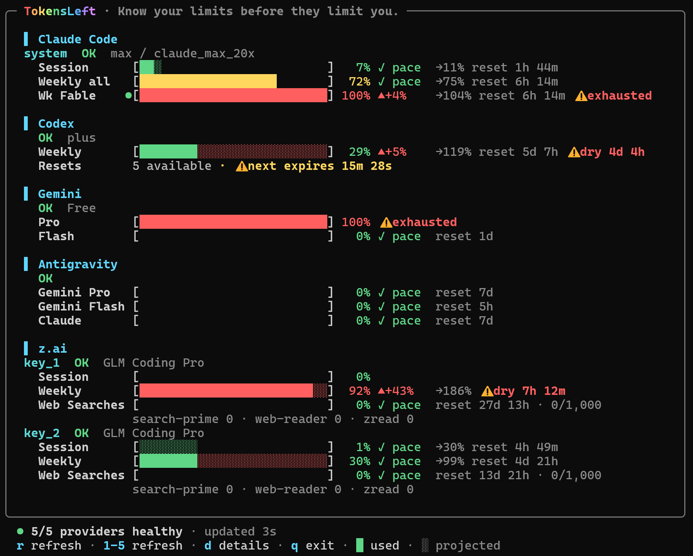
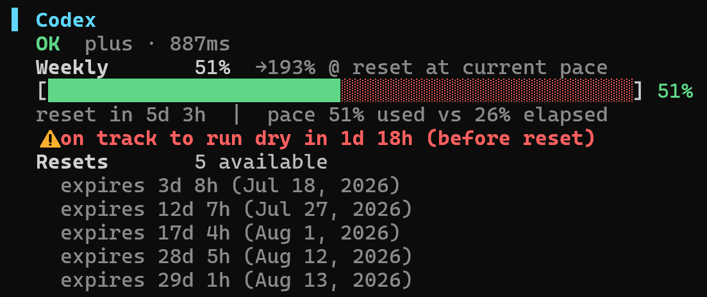

# TokensLeft

**English** · [繁體中文](README.zh-TW.md) · [简体中文](README.zh-CN.md) · [日本語](README.ja.md) · [한국어](README.ko.md)

A fast terminal dashboard for AI subscription quotas, reset times, burn rate, and local model usage.





## Quick start

```sh
npx tokensleft
```

TokensLeft automatically detects logged-in Claude Code, Codex, Gemini CLI, Kimi Code, GitHub Copilot, Grok, Antigravity CLI (`agy`) / IDE, OpenCode, and z.ai accounts. Requires Node.js 20.18.1 or newer. OpenCode and the Antigravity IDE database require `node:sqlite` (Node.js 22.13+); agy CLI keyring login also works on Node 20.

## Commands

```text
tokensleft [providers...] [options]

--demo            run with realistic local demo data
--once            print one plain-text snapshot and exit
--json            print one JSON snapshot and exit
--interval <s>    override the refresh interval
--read-only       never refresh or persist credential changes
-h, --help        show help
-v, --version     show the installed version
```

Choose any combination, for example `tokensleft claude codex`. With no provider names, every detected provider is shown.

Use `tokensleft agy` (alias for `antigravity`) for Antigravity CLI quota. Google moved free and Google AI Pro / Ultra users from Gemini CLI to agy on June 18, 2026; the separate `gemini` provider retains legacy Gemini CLI credentials and local logs. See the [official transition announcement](https://github.com/google-gemini/gemini-cli/discussions/27274).

## TUI keys

`r` refresh all · `1`–`9` refresh one provider · `d` toggle details · `t` reset history (after one is detected) · `?` help · arrows/PgUp/PgDn/mouse scroll · `q`/Esc quit

256 colors are used by default. For limited consoles, set `TOKENSLEFT_COLOR=basic` or `NO_COLOR=1`.

## Credentials and privacy

- Existing CLI credentials are discovered locally; manual keys can be placed in `~/.tokensleft/.env` or `./.env`. See [.env.example](.env.example).
- Antigravity prefers agy CLI's OS keyring login (service `gemini`, account `antigravity`) when `~/.gemini/antigravity-cli` exists, then falls back to the IDE state DB when no CLI credential exists. Windows uses Credential Manager, macOS uses Keychain, and Linux requires `secret-tool` (`libsecret-tools`). A locked or unreadable CLI keyring is reported instead of silently showing an IDE account. Set `ANTIGRAVITY_AUTH_SOURCE=cli` or `ide` to choose; an explicit `ANTIGRAVITY_STATE_DB` selects IDE unless the source is also set. `ANTIGRAVITY_CLI_HOME` overrides the CLI directory. The dashboard identifies the credential source. Refreshed access tokens are cached privately by TokensLeft; agy's keyring is never changed, and `--read-only` disables refresh and cache writes.
- Claude Code login is read from `~/.claude/.credentials.json`, and on macOS from the `Claude Code-credentials` login Keychain item first, where macOS asks for access the first time. Whichever source holds a usable token wins, so a stale file cannot shadow a fresh login. An expiring token is refreshed and saved back to the source it came from, never over a newer one; `--read-only` disables that. With no credentials at all, local usage from Claude Code transcripts is still shown.
- Kimi Code login is detected from `~/.kimi-code/credentials/kimi-code.json` and the legacy `~/.kimi` path. The dashboard shows membership level, shared quota, parallel capacity, and available models including Kimi K3. Multiple membership keys can be supplied as `KIMI_CODE_API_KEY_1`, `_2`, and so on, with optional `KIMI_CODE_NAME_1`, `_2` labels. The original single-key `KIMI_CODE_API_KEY` remains supported; these are not Moonshot `KIMI_API_KEY` keys.
- Quota requests never pass through a TokensLeft service; they go directly to providers or through your configured proxy. There is no TokensLeft account, server, analytics, or telemetry.
- Codex's unofficial 48-hour reset chance is fetched anonymously from `willcodexquotareset.com`; no credential or account identifier is included.
- Local usage for Claude Code, Codex, Gemini CLI, Antigravity CLI, and Kimi Code is calculated from CLI logs on your machine and is never uploaded. The detail view shows input, cached input, output, and estimated API cost when pricing is available.
- agy details aggregate local SQLite conversations and implicit sessions into today / 7d / 30d / all-time model totals (Node.js 22.13+ required). These records span all local accounts; agy does not record which account paid for each generation. Legacy encrypted `.pb` sessions are excluded. Reasoning counts as output, and missing model prices remain marked as unknown rather than using a different model version's price. The databases are read only, including live WAL updates.
- Unexpected reset history is stored locally in `~/.tokensleft/reset-history.json`; only provider/window names and detection times are recorded.
- Claude Code shows saved limit resets from the usage API, including remaining count and expiry countdown. Missing or unsupported reset inventory is shown as unavailable, not zero. This only reads reset offers; use Claude to redeem them.
- Claude plans (checked November 2, 2026): [Max](https://support.claude.com/en/articles/11049741-what-is-the-max-plan) is $100/month with 5x Pro usage per five-hour session and week. [Ultra](https://support.claude.com/en/articles/17728952-what-is-the-ultra-plan) replaces Max 20x at $200/month with 10x Pro weekly usage; verified Ultra accounts have no five-hour limit. Older Max 20x credential tiers display as Ultra. Quota bars follow the usage API, including temporary session limits on unverified accounts and separate Fable weekly limits. Usage credits are separate from monthly API credits.
- The dashboard warns once within 24 hours and again within one hour before a saved reset expires. These reminders run while TokensLeft is open and never redeem a reset.
- OpenCode Go/Go Plus quotas use server-reported percentages and reset times; local message costs are shown only as local usage, not as subscription allowance. A missing quota response stays unavailable. `OPENCODE_GO_API_KEY` can supply a Go key without a local login.
- Copilot distinguishes AI-credit billing from legacy request quotas, including fractional credits and overage permission when reported. Organization budgets not exposed to the member remain unavailable.
- Gemini and Antigravity show Google AI-credit balances when supplied by the account API, and the user-level overage preference. Project or managed settings may override that preference. Antigravity also shows the reported plan: a free Starter quota is not a paid subscription or proof of access to paid models.
- Antigravity reads the quota summary for the authenticated account's project, showing separate 5-hour and weekly windows for each server-reported model group. Percentages show usage, matching the rest of the dashboard. Optional credit and overage rows are hidden when unavailable; CLI overage preferences also read the shared `~/.gemini/config/config.json` settings. Credential-source information appears in the detail view.
- OAuth credentials may be refreshed and safely written back when needed. Use `--read-only` to disable refreshes and persistent credential updates.

Local dollar totals are estimates based on public API prices, not subscription billing. Prices use an embedded LiteLLM/models.dev snapshot, refresh at most once per day, and fall back to the last known good copy when offline. Unknown or partial prices are marked instead of being treated as complete. Forecasts are simple linear projections, not guarantees.

## Development

```sh
git clone https://github.com/tokensleft/tokensleft.git
cd tokensleft
npm ci
npm test
npm run lint
npm run demo
```

`npm run pricing:update` regenerates the embedded model price snapshot from LiteLLM and models.dev.

[Security policy](SECURITY.md) · MIT licensed.
