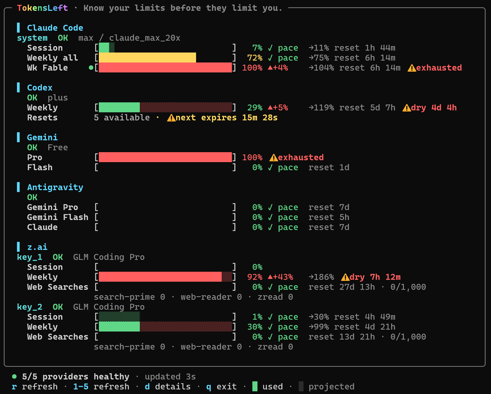
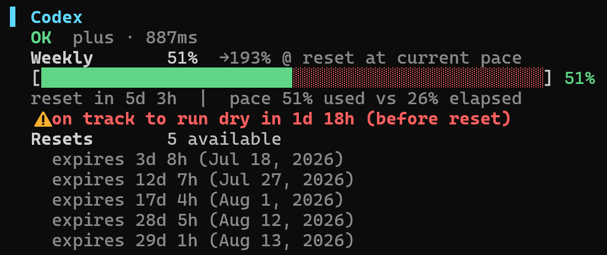

# TokensLeft

[English](README.md) · **繁體中文** · [简体中文](README.zh-CN.md) · [日本語](README.ja.md) · [한국어](README.ko.md)

快速查看 AI 訂閱額度、重置時間、消耗速度與本機模型用量的終端儀表板。





## 快速開始

```sh
npx tokensleft
```

TokensLeft 會自動偵測已登入的 Claude Code、Codex、Gemini CLI、Kimi Code、GitHub Copilot、Grok、Antigravity CLI（`agy`）／IDE、OpenCode 與 z.ai。需要 Node.js 20.18.1 以上版本；OpenCode 與 Antigravity IDE 資料庫需要 `node:sqlite`（Node.js 22.13 以上），agy CLI 的 keyring 登入也支援 Node 20。

使用 `tokensleft agy`（`antigravity` 的別名）查詢 Antigravity CLI 配額。Google 已於 2026/6/18 將免費與 Google AI Pro／Ultra 的 Gemini CLI 使用者遷移至 agy；`gemini` 欄位仍保留舊版憑證與本地紀錄支援。參見[官方公告](https://github.com/google-gemini/gemini-cli/discussions/27274)。

偵測到 `~/.gemini/antigravity-cli` 時，程式優先讀取 agy 的系統 keyring 登入（Windows Credential Manager／macOS Keychain／Linux Secret Service；Linux 需安裝 `secret-tool`），沒有 CLI 憑證才讀 IDE 資料庫。CLI keyring 讀取失敗時會顯示錯誤，避免誤用另一個 IDE 帳號。可用 `ANTIGRAVITY_AUTH_SOURCE=cli` 或 `ide` 指定來源；設定 `ANTIGRAVITY_STATE_DB` 預設選擇 IDE。詳細模式會標示憑證來源，更新的 access token 僅快取至 TokensLeft，不改寫 agy keyring；`--read-only` 禁止更新 token 或寫入快取。

詳細模式也會顯示 agy 本地 SQLite 紀錄的各模型用量，包含今日／7 日／30 日／全部歷史的輸入、快取、輸出 token 與 API 費用估算（需 Node.js 22.13 以上）。本地紀錄涵蓋所有帳號，舊版加密 `.pb` 紀錄不計入；缺少價格時會標示未知，不套用其他模型版本的價格。

agy 會依登入帳號的 project 查詢完整配額摘要，分別顯示各模型群組的 5 小時與 weekly 用量及重設時間；百分比代表已使用量。沒有資料的 credits／overage 列會隱藏；CLI 的 overage 設定也會讀取共用的 `~/.gemini/config/config.json`。

## 指令

```text
tokensleft [providers...] [options]

--demo            使用擬真的本機示範資料
--once            輸出一次純文字結果後結束
--json            輸出一次 JSON 後結束
--interval <秒>   覆寫更新間隔
--read-only       不刷新或永久寫回憑證
-h, --help        顯示說明
-v, --version     顯示安裝版本
```

可以指定任意組合，例如 `tokensleft claude codex`；未指定時會顯示所有偵測到的 Provider。

## TUI 按鍵

`r` 全部更新 · `1`–`9` 更新單一 Provider · `d` 切換詳細模式 · `t` 重置歷史（偵測過才顯示） · `?` 說明 · 方向鍵/PgUp/PgDn/滑鼠捲動 · `q`/Esc 離開

預設使用 256 色；受限終端可設為 `TOKENSLEFT_COLOR=basic` 或 `NO_COLOR=1`。

## 憑證與隱私

- 自動讀取本機 CLI 的既有登入資料；手動金鑰可放在 `~/.tokensleft/.env` 或 `./.env`，完整變數請見 [.env.example](.env.example)。
- Claude Code 登入資料會從 `~/.claude/.credentials.json` 讀取；macOS 上會優先讀 login Keychain 中的 `Claude Code-credentials` 項目，首次讀取時系統會詢問授權。哪個來源有可用的 token 就用哪個，過期的舊檔不會蓋掉新的登入。快到期的 token 會自動更新並寫回原本的來源，且不會覆蓋更新的憑證；`--read-only` 可停用。完全沒有憑證時，仍會顯示來自 Claude Code 轉錄檔的本機用量。
- Kimi Code 會讀取 `~/.kimi-code/credentials/kimi-code.json`，並相容舊版 `~/.kimi` 路徑；面板會顯示會員等級、共享額度、並行上限與包含 Kimi K3 在內的可用模型。多把會員金鑰可設為 `KIMI_CODE_API_KEY_1`、`_2` 等，並用 `KIMI_CODE_NAME_1`、`_2` 自訂名稱。原本的單一 `KIMI_CODE_API_KEY` 仍可使用；這些不是 Moonshot 的 `KIMI_API_KEY`。
- 額度請求不會經過 TokensLeft 服務，只會直連各 Provider 或使用你設定的 proxy；TokensLeft 沒有帳號系統、伺服器、分析或遙測。
- Codex 的非官方 48 小時重置機率會匿名向 `willcodexquotareset.com` 取得，不會附帶憑證或帳號識別資訊。
- Claude Code、Codex、Gemini CLI 與 Kimi Code 的本機用量只從電腦上的 CLI 紀錄計算，不會上傳；詳細模式會顯示輸入、快取輸入、輸出，以及有公開價格時的 API 費用估算。
- 非預期重置歷史只會儲存在本機 `~/.tokensleft/reset-history.json`，內容僅有 Provider、額度項目名稱與偵測時間。
- Claude 方案（2026-11-02 查核）：[Max](https://support.claude.com/en/articles/11049741-what-is-the-max-plan) 為每月 US$100，五小時及每週用量各為 Pro 的 5 倍；[Ultra](https://support.claude.com/en/articles/17728952-what-is-the-ultra-plan) 取代 Max 20x，每月仍為 US$200，每週用量為 Pro 的 10 倍，通過驗證後取消五小時限制。舊 Max 20x 憑證會顯示為 Ultra；額度條依 API 實際回傳顯示，保留未驗證帳號的暫時 Session 限制及 Fable 獨立週額度。Usage credits 與每月附贈的 API credits 分開計算。
- OAuth 憑證需要時會安全更新並寫回；使用 `--read-only` 可停用刷新與永久憑證更新。

本機美元金額依公開 API 價格估算，不代表訂閱帳單。價格使用內建的 LiteLLM/models.dev 快照，每日最多更新一次；離線時會沿用上次有效資料。未知或不完整價格會明確標示。預測採簡單線性推估，並非保證。

## 開發

```sh
git clone https://github.com/tokensleft/tokensleft.git
cd tokensleft
npm ci
npm test
npm run lint
npm run demo
```

`npm run pricing:update` 會從 LiteLLM 與 models.dev 重新產生內建的模型價格快照。

[安全政策](SECURITY.md) · 採 MIT 授權。
